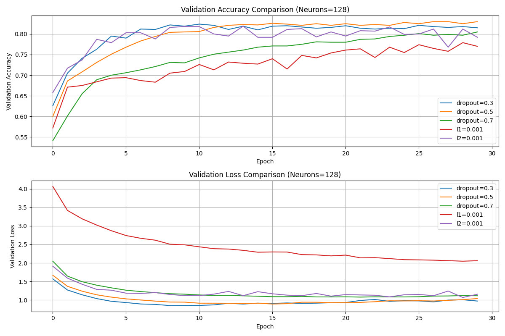
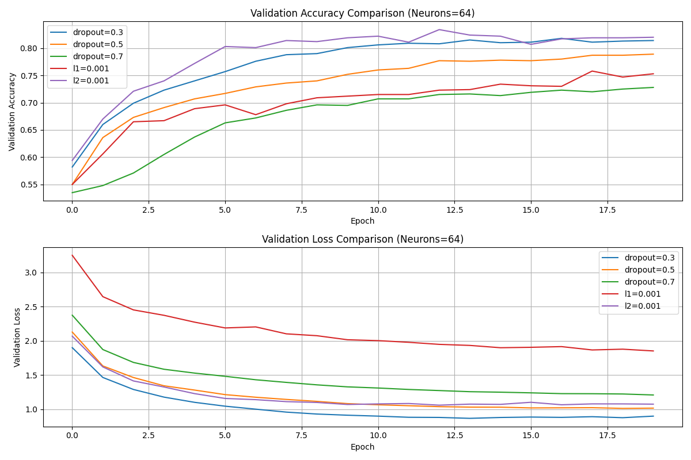

# Reuters News Classification with Keras: Regularization Comparison

Multi-class (46 topics) text classification on the Reuters newswire dataset. A dense baseline network is trained,
shown to overfit when enlarged, and then compared against L1, L2, Dropout and combined regularization.

> Persian summary / خلاصه فارسی: طبقه‌بندی ۴۶ کلاسه‌ی اخبار رویترز با Keras و مقایسه‌ی روش‌های L1، L2 و Dropout برای کاهش overfitting.

## Overview

| Item | Details |
|---|---|
| Task | Single-label, 46-class newswire topic classification |
| Data | `keras.datasets.reuters`, top 10,000 words — 8,982 training / 2,246 test samples |
| Input | Multi-hot (one-hot) word vector of size 10,000 |
| Model | Fully connected `Sequential` network, ReLU hidden layers, `softmax` output |
| Loss / optimizer | `categorical_crossentropy` / `rmsprop` (batch size 512) |
| Validation | 1,000 training samples held out |
| Python | 3.11 (from notebook metadata) |

## Notebooks

| Notebook | Content |
|---|---|
| [`notebooks/01_regularization_experiments.ipynb`](notebooks/01_regularization_experiments.ipynb) | Baseline (64-64), overfitting demonstration (512-512 and 128-128), L2 / L1 / L1+L2 / Dropout / Dropout+L2 experiments and a 27-configuration grid (128-128, 30 epochs). **Validation** metrics only. |
| [`notebooks/02_base_vs_regularized_test_evaluation.ipynb`](notebooks/02_base_vs_regularized_test_evaluation.ipynb) | Compact, function-based version: tunes L2 and Dropout on a validation split, then evaluates the baseline and the best regularized model on the **test set**. Contains two early drafts before the final version (see headings inside). |

Figures were removed from the saved notebook outputs to keep the files small; the main plots are in [`results/`](results/).

## Results

All numbers below are copied from the saved notebook outputs. They come from single runs without a fixed random seed,
so repeating the experiment will give slightly different values.

### Validation accuracy, 128-128 network, 30 epochs (notebook 01)

Final-epoch accuracy on the 1,000-sample validation set. The unregularized 128-128 baseline reaches about 0.81
(train 0.963 / validation 0.812).

| Setting | Train acc. | Validation acc. |
|---|---|---|
| Dropout 0.5 + L2 0.0001 | 0.941 | 0.827 |
| Dropout 0.5 | 0.940 | 0.821 |
| Dropout 0.3 + L2 0.0001 | 0.958 | 0.819 |
| Dropout 0.3 | 0.962 | 0.817 |
| L1 0.0001 + L2 0.0001 | 0.938 | 0.815 |
| L2 0.0001 | 0.958 | 0.801 |
| Dropout 0.7 + L2 0.01 | 0.715 | 0.708 |
| L1 0.01 | 0.579 | 0.578 |

Observations supported by the experiments:

- Moderate Dropout (0.3–0.5), alone or with a small L2 term, gave the highest validation accuracy and a smaller train/validation gap than the unregularized model.
- Strong regularization (L1 = 0.01, Dropout 0.7 with large L2) underfits: both training and validation accuracy drop sharply.
- The differences between the best settings are about 1–2 percentage points. With a 1,000-sample validation set (standard error ≈ 1.2 points) and no repeated runs, they should not be read as a reliable ranking.

### Test accuracy, 64-64 network (notebook 02, final version)

| Model | Test loss | Test accuracy |
|---|---|---|
| Baseline | 0.9973 | 0.7979 |
| L2 = 0.001 + Dropout = 0.3 (best on validation) | 1.1683 | 0.7930 |

In this run the regularized model did **not** improve test accuracy over the baseline. The two earlier draft cells in that notebook
use different settings and report different numbers; they are kept only as a record of the exploration.

### Figures

Validation accuracy and loss comparison, 128 neurons per hidden layer:



Same comparison with 64 neurons per hidden layer:



Per-setting training curves (Dropout 0.3 / 0.5 / 0.7, L1 = 0.001, L2 = 0.001) for both sizes are in [`results/`](results/).

## Getting started

```bash
git clone <repository-url>
cd reuters-regularization-keras
python -m venv .venv
.venv\Scripts\activate        # Windows (macOS/Linux: source .venv/bin/activate)
pip install -r requirements.txt
jupyter notebook
```

Open a notebook from `notebooks/` and run all cells. The Reuters dataset is downloaded automatically by Keras on first use.
Notebook 01 trains many models and takes a while on CPU.

## Limitations

- Bag-of-words (multi-hot) input: word order is ignored.
- Hyperparameters were selected on one fixed validation split and results are not averaged over several seeds.
- Notebook 01 reports validation scores only; use notebook 02 for test-set numbers.

## Academic note

Individual university coursework (deep learning).

## License

MIT — see [LICENSE](LICENSE).
